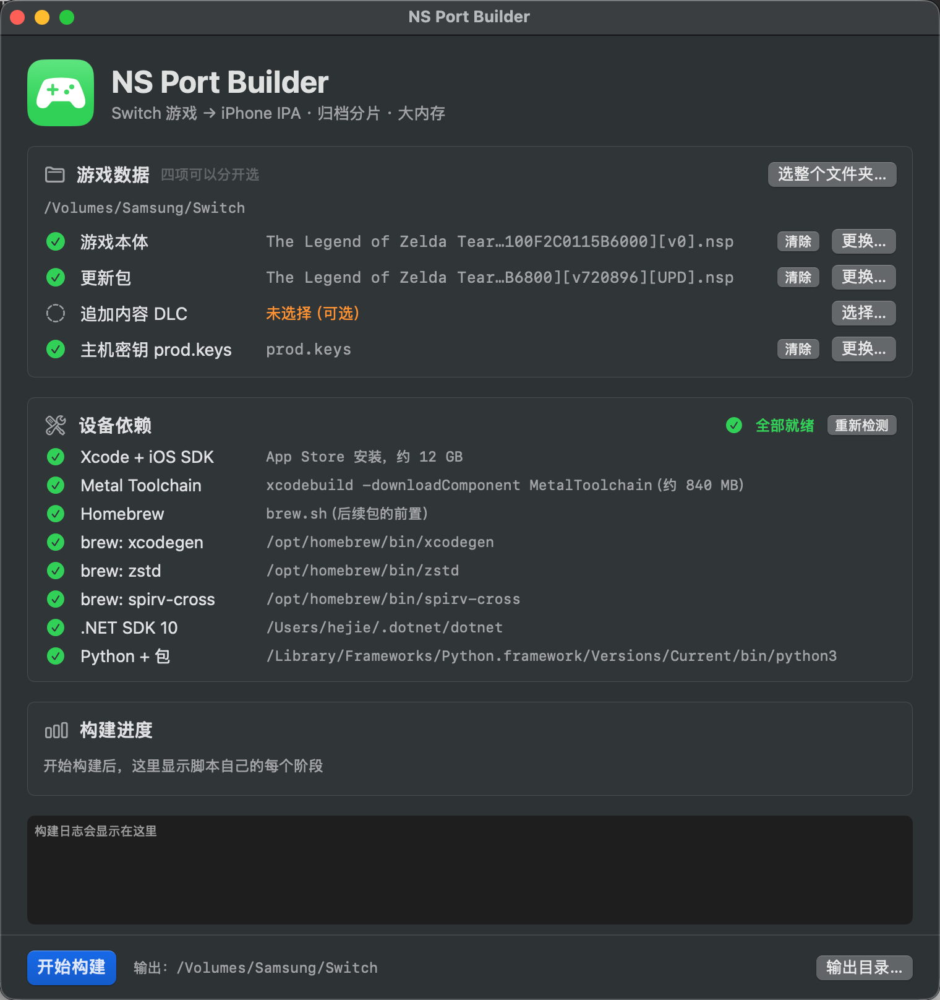

# nxnative + RomFS Archive

Run your own Nintendo Switch games natively on iPhone and iPad — and ship games whose resource
files are too large (or too numerous) for a normal iOS install.

This repository is **[nxnative](https://github.com/seedds/nxnative) with one new subsystem: a RomFS
archive**. Everything about running the game — the NSO rewriter, the Horizon host, the NVN-on-Metal
layer, the per-game profiles — is upstream work. What is new here is a way to pack a RomFS tree into
~100 files and have the app read it directly, which makes large games installable and their files
copyable in one operation.

English | [简体中文](README.zh-CN.md)

---

## The problem

A RomFS like Tears of the Kingdom's is **304,243 files / 15.9 GiB**. Two things break:

- **The IPA does not install.** A 16.6 GB package with 372,660 entries fails on iOS with
  `PackageExtractionFailed (Could not extract archive)`. The install daemon's extractor gives up —
  one directory holds 75,941 files and the ZIP64 central directory starts at 17.8 GB.
- **Copying the tree to the phone takes hours.** The Files app and Finder do one round trip per
  file. 300,000 small files also produce roughly 1 GB of filesystem block overhead.

Packing the tree into ~100 shard files solves both: the package stays small, and the game files move
to the phone as one folder of large files.

## The fix

A **ROMFSARC** archive: one index file plus N shard files.

```
romfs.idx        28 MB   header, name pool, file table, directory table
romfs.00 ... .125        126 shards, 200 MiB each, source bytes verbatim
```

Measured on Tears of the Kingdom (v1.0.0 + 1.4.3):

| | Plain RomFS | ROMFSARC |
|---|---|---|
| Files | 304,243 | **127** |
| Largest directory | 75,941 entries | 126 shards, none over 200 MiB |
| IPA with the game inside | 16.6 GB (fails to install) | — |
| Slim IPA (the default, no RomFS inside) | — | **743 MB, installs** |
| Copy to the phone | hours | one folder of 127 files |

Path lookup is a binary search over the sorted file table; a directory listing walks one contiguous
child range. The index is `mmap`ed, shards are opened lazily, and reads go straight to `pread` on
the shard, so the page cache still works.

## The GUI front end

`frontend/` is a macOS app that does steps 2–5 below with a window instead of a terminal, for
people who would rather not read a build log: four inputs picked separately (base game, update,
DLC, `prod.keys`), a dependency panel that detects and installs what is missing, the script's real
stage list with live percentages, and the archive shards produced at the end.



```bash
cd frontend && swift run          # or double-click frontend/NS Port Builder.app
```

It runs the same scripts the command line does, so everything below still applies; see
[frontend/README.md](frontend/README.md).

## Using it

### 1. Build the app (as upstream)

The archive feature does not change the normal build. Follow upstream's
[README](https://github.com/seedds/nxnative) to install Xcode, Homebrew tools and the Python
packages, then pack an IPA.

```bash
git clone https://github.com/<you>/nxnative-romfs-archive.git
cd nxnative-romfs-archive
brew install xcodegen zstd spirv-cross
brew install --cask dotnet-sdk
python3 -m pip install lz4 capstone fonttools backports.zstd
```

### 2. What you need on disk

Three things, none of which ship with the repository:

| What | Where it comes from | Used by |
|---|---|---|
| **`prod.keys`** | dumped from **your own console** (see below) | the extractor, to decrypt your game |
| **The game's NSPs** | dumped from your own cartridge or eShop purchases | the extractor |
| **Xcode + iOS SDK** | the App Store | the app build |

`prod.keys` is the console's key set — a text file of `name = hex value` lines (~230 entries:
`master_key_xx`, `titlekek_xx`, `header_key`, `key_area_key_application_xx`, …). Every Switch
homebrew tool reads this format. It is **not** tied to a specific game: one `prod.keys` decrypts
any of your games. The only requirement is that the file contains keys for the key generation
(firmware era) the game was packaged with — a current dump covers every retail game.

Where to put it is up to you; you pass the path with `-k`:

```bash
# any layout works, e.g.
~/keys/prod.keys
# or keep it beside the game's NSPs
~/Games/Hades2/prod.keys
```

```bash
python3 scripts/build_ipa_from_nsp.py ~/Games/Hades2 -k ~/keys/prod.keys
```

How keys are dumped is documented across the Switch homebrew community (Lockpick_RCM from a
hacked console is the usual route); this repository does not cover that step and ships none of
it. Two practical notes from real dumps:

- **Malformed lines.** Some dumpers emit lines whose hex value has the wrong length (33 bad
  `master_kek_source_*` lines in one real dump), which makes the extraction tool refuse the whole
  file. Delete the offending lines and keep a backup of the original.
- **Updates.** An update NSP's ticket may carry a newer key generation than the base game's. The
  extractor reads the title key straight from the common ticket inside each NSP, so in practice
  both decrypt fine as long as `prod.keys` is reasonably current — verified here with a base
  game on generation 15 and its update on 16, using a keys file that only reached 15.

`backports.zstd` is needed for Tears of the Kingdom's zstd dictionaries; other games do not use it.

### 3. Pack the RomFS into an archive

```bash
python3 dm/tools/romfs_arc.py pack <RomFS dir> <output base> --shard-mib 200
```

`<RomFS dir>` is the directory `nx_extract` wrote (the one holding `Pack/`, `Banc/`, `Sound/`, …).
The tool writes `<base>.idx` and `<base>.00`, `<base>.01`, … Files are grouped by top-level
directory and cut so no shard passes `--shard-mib`, so one shard holds one kind of content.

Check the result before copying anything:

```bash
python3 dm/tools/romfs_arc.py verify <base> <RomFS dir>   # byte-compares every file
python3 dm/tools/romfs_arc.py list   <base> [path]        # list one directory
```

### 4. Build the IPA

The main build script packs a **slim IPA by default** (no RomFS inside; the app reads the game
files from `Documents/romfs`), so step 1 already produced it. To re-pack just the package later:

```bash
GAME=<title id> W=<work dir> PATCHED=<patched dir> \
  ROMFS=<RomFS dir> MSL_IOS=<shader dir> \
  dm/ios/tools/build_ipa.sh <output.ipa>
```

`--full-romfs` (or `DM_FULL_ROMFS=1`) packs the RomFS into the package instead — upstream's
behaviour, only sensible for small games.

### 5. Copy the archive to the phone

Put the whole set in the app's `Documents/romfs/`, keeping the base name:

```
Documents/romfs/romfs.idx
Documents/romfs/romfs.00
...
Documents/romfs/romfs.125
```

The app looks for `romfs.idx` first (`dm/ios/Sources/main.m`, `romfs_locate`). A plain directory
tree is still accepted when there is no index, so nothing changes for existing games.

The index may sit at any of these places; the reader tries them in order:

```
<DM_ROMFS>.idx
<DM_ROMFS>/romfs.idx
<DM_ROMFS>/romfs/romfs.idx
```

## Playing

**Touch controls.** Two layouts (tap the button at the top centre to switch): 2D (left stick,
A/B/X/Y, shoulders, − / +) and 3D (adds a D-pad, a right stick and L3 / R3). With no controller
connected, touches outside the controls go to the game's touch screen.

**Physical controllers** (GameController framework: Xbox, PlayStation, Switch Pro and MFi pads all
work) hide the touch controls entirely while connected and bring them back when disconnected;
meanwhile every touch goes to the game's touch screen. Buttons map by position, as on a Switch
controller: bottom = B, right = A, left = Y, top = X, and the D-pad and right stick are kept.

**Settings without rebuilding:** `Documents/env.txt`, one `KEY=VALUE` per line. Common ones:

```
DM_LANG=zh-Hans        # Chinese (en-US by default)
DM_FPS_TARGET=30       # cap the frame rate (saves battery; the profile's fps_target by default)
DM_OPMODE=0            # handheld mode: 720p render instead of the docked 1080p
```

**Saves and logs** are in the Files app under the app's name: `save/` and `log.txt`. When something
goes wrong, send `log.txt` (the previous run is `log.prev.txt`). Short stutters the first time a new
scene appears are normal: the app compiles graphics for it once and remembers them.

## Using it for another game

The archive format has nothing game-specific in it: the packer walks whatever directory you give it
and the reader looks paths up in that tree. To switch games:

1. Extract the new game's NSPs with `nx_extract` as usual (upstream's script does this).
2. Pack that game's `RomFS` with `romfs_arc.py`.
3. Rebuild the IPA with the new `GAME=` profile (the slim package is the default).
4. Copy the new archive into `Documents/romfs/`.

Three things to watch for:

- **The shard count must stay at or below 256.** The reader keeps one fd slot per shard
  (`MAX_SHARDS` in `romfs_arc.h`). The packer now refuses to write an index above that and tells you
  which `--shard-mib` would fit. Tears of the Kingdom needs 126 at 200 MiB; a game about twice its
  size would need 256 MiB shards.
- **DLC is not archived.** Add-on content still goes into the package (`DmIOS.app/aoc/<index>/`) and
  is mounted as a directory. Most DLC is small enough that this does not affect installation; if you
  hit the installer limit again, drop the DLC from the package and it stays unowned.
- **`zip_store` is per game.** The profile lists extensions that are already compressed and should be
  stored rather than deflated (`.zs`, `.bwav`, `.mc`, `.webm`, `.metallib` for Tears of the Kingdom).
  This only affects the package the shader libraries and tables go into, not the archive.

Games from upstream's tested list (4–6 GB) need roughly 20–30 shards at 200 MiB, well inside the
limit, and their memory footprint is far below the per-app budget that stops Tears of the Kingdom.

## What changed against upstream

Five files added, four modified. The fs layer keeps its normal path handling: when an archive is
open, `host_path_ex` hands out a synthetic path (`@romfsarc:<guest path>`) for entries on the
archive mount, and `OpenFile` / `GetEntryType` / `OpenDirectory` / the directory calls route those
to the archive. File handles for archive entries are tagged with bit 63 so they never collide with
real fds, and `ReadFile` clamps to the file size (a shard is a flat container, so an unclamped read
past the end would return the next file's bytes).

| File | Change |
|---|---|
| `dm/host/romfs_arc.h` | new — archive format and reader interface |
| `dm/host/romfs_arc.c` | new — mmap index, binary-search lookup, lazy shard fds |
| `dm/tools/romfs_arc.py` | new — pack / verify / list |
| `dm/host/tests/t_romfs_arc.c` | new — walks a whole archive, checks every file |
| `docs/ROMFS_ARCHIVE.md` | new — format and design notes |
| `dm/host/hle_fs.c` | mount and route archive-backed paths |
| `dm/host/Makefile` | build `romfs_arc.c` |
| `dm/ios/Sources/main.m` | `romfs_locate` accepts `romfs.idx` |
| `dm/ios/tools/build_ipa.sh` | slim by default (`DM_FULL_ROMFS=1` = upstream full package) |
| `scripts/build_ipa_from_nsp.py` | `--work-dir` (build folder away from the NSPs); derives `DOTNET_ROOT` (a framework-dependent `nx_extract` will not start from a plain shell without it) |
| `frontend/` | new — macOS GUI front end (see [The GUI front end](#the-gui-front-end)) |

The mount is recognised by its **directory**, not its name: titles differ (`rom` for most games,
`content` for Tears of the Kingdom).

## Verified on

- **Tears of the Kingdom** (0100F2C0115B6000, v1.0.0 + update 1.4.3): 304,243 files packed into 127
  files; all 304,243 byte-compared against the source (`verify: OK`); the game runs from the archive
  on macOS (1,905 frames at 30 fps).
- **Hades II** (0100A00019DE0000, base + update 1.0.137848): 5,258 files packed into 33 files,
  byte-compare OK, and the game runs from the archive on macOS (2,100 frames, 1,772 archive reads).
  The update needs no special handling: `nx_extract` already layers the update NCA over the base
  with `OpenFileSystemWithPatch`, so the extracted RomFS — and therefore the archive — is the merge.
  **Playable on an iPhone** (12 GB device, AltStore Classic 2.3) once the memory entitlement is in
  effect — see below.
- The C reader walks all 304,243 Tears of the Kingdom files and 2,667 directories in 7.6 s.

**The jetsam budget is the limit on big titles, and it can be raised.** Without
`com.apple.developer.kernel.increased-memory-limit` an iPhone gives this app ~3,375 MB (measured on
a 12 GB device: Tears of the Kingdom was killed entering the world map at 3,342 MB resident with
33 MB of headroom; lowering the render scale to 0.5 did not change it, so the limit is the guest
heap, not the GPU). The app requests the entitlement and `build_ipa.sh` embeds it in a placeholder
ad-hoc signature — an unsigned binary has no signature for a sideloader to read entitlements from,
so without that step the request would be lost. **AltStore Classic 2.2+**, **Impactor** and **Xcode
with a Personal Team** keep it; **SideStore** with a free Apple ID needs a one-time App ID fix;
**Sideloadly** does not. See [dm/ios/ENTITLEMENTS.md](dm/ios/ENTITLEMENTS.md) for the steps and how
to tell from `Documents/log.txt` (resident + headroom: ~3,375 MB = not in effect, 6–8 GB = it is).

## Limitations

- **Read-only.** The archive is never written; saves and temp data go to their own mounts as before.
- **Case-sensitive lookup.** Names are stored as the source tree had them, so the host's
  case-insensitive alias machinery (for APFS) is bypassed for archive entries.
- **Symlinks are followed at pack time.** No supported game's RomFS has any.
- **The index is held in memory.** 28 MB for Tears of the Kingdom (17.9 MB of it names). Shards are
  not.
- **No dedup or compression.** Shards are the source bytes verbatim, so `verify` is a plain
  comparison and a repack is deterministic.

## Credits

All of the emulation work is other people's. This repository adds the archive subsystem on top:

- **[nxnative](https://github.com/seedds/nxnative)** (MIT) — the native-execution toolchain this
  repository is built from: the NSO rewriter, the Horizon host layer, NVN-on-Metal, the per-game
  profiles and the iOS shell.
- **[d2r-mobile](https://github.com/jhaizhou-ops/d2r-mobile)** (MIT) — the original native-execution
  approach that nxnative grew out of.
- **Ryujinx** (MIT) — the shader translator that turns Maxwell shaders into SPIR-V.
- **[Atmosphère](https://github.com/Atmosphere-NX/Atmosphere)** — the reference for Horizon's
  synchronization semantics.
- **[LibHac](https://github.com/Thealexbarney/LibHac)** — reads NSPs and layers updates in
  `nx_extract`.
- **[SPIRV-Cross](https://github.com/KhronosGroup/SPIRV-Cross)** — SPIR-V to Metal Shading Language.
- **yuzu**, **deko3d**, **libvpx**, **stb_vorbis**, **libdeflate** — see upstream's acknowledgement
  list for what each contributes.

`dm/third_party` ships other projects with their licenses ([list](dm/third_party/README.md)).

## Legal

This repository contains no game code, art, text, data tables or shaders, and distributes none. You
need your own legally owned copy of a game and its `prod.keys`. The archive tool only reads the game
files you already extracted on your own machine; nothing is uploaded anywhere.

Not affiliated with Nintendo or any game publisher.
